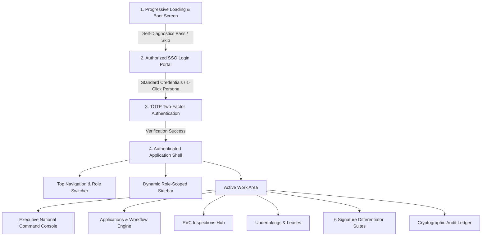
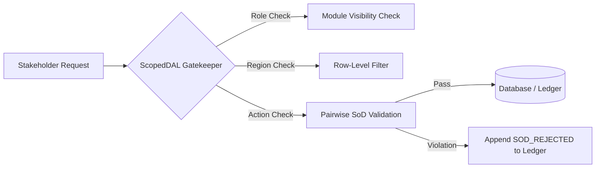

# AICTE Approval & Compliance Automation System
## Complete System Architecture, Operational Manual & Technical Specification

---

### Executive Overview

The **AICTE Approval & Compliance Automation System** is an enterprise-grade statutory governance portal engineered in alignment with the **All India Council for Technical Education (AICTE) Approval Process Handbook (APH 2024–27)** and the **Digital Personal Data Protection (DPDP) Act 2023**. 

The system transitions AICTE’s technical institution approvals from fragmented, manual inspection queues into a **data-driven, transparent, and auditable digital workflow**, featuring explainable AI (XAI), automated panel dispatch, cryptographic audit ledgers, and strict statutory separation of duties (SoD).

---

## 1. System Topology & Technology Stack

The platform is designed around a decoupled, service-oriented architecture:

```
┌────────────────────────────────────────────────────────────────────────┐
│                        FRONTEND (Next.js 14 App Router)                │
│  • React 18 + TypeScript + Tailwind CSS                                │
│  • Cherry Blossom Statutory Theme (HSL Curated, Contrast Ratio > 4.5:1) │
│  • Lucide React Icons + Chart.js + HTML5 Canvas                       │
│  • Role-Aware Scoped State (AppContext)                                │
│  • Port: http://localhost:3000                                         │
└───────────────────────────────────┬────────────────────────────────────┘
                                    │ REST API / JSON (x-user-role, x-user-id)
┌───────────────────────────────────▼────────────────────────────────────┐
│                       BACKEND (FastAPI / Python 3.11+)                  │
│  • RESTful API Endpoints with Pydantic Schema Validation               │
│  • ScopedDAL: Row-Level Security (RLS) & Default-Deny Scoping          │
│  • APH Rules Engine: 5 Pipelines, Stage SLAs & Pause/Cure Logic        │
│  • TreeSHAP & XGBoost/RandomForest Next-Best-Action Scorer             │
│  • SHA-256 Cryptographic Hash Chainer (Append-Only Audit Ledger)        │
│  • Uvicorn ASGI Server on http://127.0.0.1:8000                        │
└───────────────────────────────────┬────────────────────────────────────┘
                                    │ SQLAlchemy ORM
┌───────────────────────────────────▼────────────────────────────────────┐
│                             DATA STORE                                 │
│  • SQLite (Development / Demo): aicte_dev.db                           │
│  • PostgreSQL (Production Specification): schema_rls_postgres.sql      │
│  • Seed Data: 210 Institutions, 7 Regional Offices, 5 Document Types  │
└────────────────────────────────────────────────────────────────────────┘
```

### Core Technologies
- **Frontend**: Next.js 14 (App Router), TypeScript, Vanilla CSS + Tailwind CSS utilities, Lucide React icons.
- **Backend**: FastAPI, Python 3.11+, SQLAlchemy 2.0 ORM, Pydantic v2 schemas.
- **Security & Crypto**: PBKDF2-HMAC-SHA256 password hashing, PyJWT tokens, SHA-256 Merkel-style hash chaining for audit trails.
- **Analytics & Explainability**: Decision-tree scoring engine modeled on TreeSHAP for explainable AI recommendations.

---

## 2. End-to-End User Flow & Screen Architecture



### 2.1 Screen 1: System Boot & Diagnostic Loading Screen
- **Visual Design**: Clean white background (`#FFFFFF`) with a central console highlighted in subtle cherry blossom tones (`#FFF0F5` to `#E84370`).
- **Functionality**:
  - Automatically simulates 5 progressive system health checks:
    1. Core Engine Handshake (`/api/v1/health`)
    2. APH 2024–27 Rules Registry compilation
    3. Regional Office network synchronization (SWRO, SRO, WRO, NRO, ERO, CRO, NWRO, HQ)
    4. Cryptographic SHA-256 ledger integrity verification
    5. Role-Based Access Control (RBAC) security matrix initialization
  - Includes progressive percentage meter (0% to 100%).
  - Fast-path **"Skip to Login"** button allows immediate transition without waiting.
  - A persistent execution guard (`completedRef`) ensures that timer cancellations or component re-renders never result in a blank white page.

### 2.2 Screen 2: Authorized SSO Login Screen
- **Tab Order (Strictly Configured)**:
  1. **Standard Credentials (Default / Primary)**: Official AICTE login form with government email, masked password, demo quick-fill presets (`SWRO Officer`, `Institution`, `Member Secretary`), and 5-attempt brute-force lockout protection.
  2. **1-Click Demo Personas (Secondary)**: Grid of 6 interactive stakeholder persona cards designed for evaluators to switch roles instantly with a single click.
- **Two-Factor Authentication (TOTP MFA)**:
  - Triggered after credentials verification.
  - Prompts for a 6-digit TOTP security code (Demo code: `123456`).
  - Upon validation, issues an authorized session token with user ID, assigned role, and regional boundary.

---

## 3. The 6 Stakeholder Roles, Data Scoping & Decision Rights

The portal implements strict **Row-Level Security (RLS)**, **Default-Deny Scoping**, and **Pairwise Separation of Duties (SoD)**.



### Detailed Authority Matrix

| Role | Persona & Email | Visible Navigation Items | Data Jurisdiction (Row-Level Security) | Operational Decision Power | Strict Prohibitions |
| :--- | :--- | :--- | :--- | :--- | :--- |
| **1. Institution User (Applicant)** | Dr. Ramesh Kumar<br>`principal.110000001@fictional-aicte.edu.in` | • Executive Dashboard<br>• Applications & Routing<br>• Undertakings & Leases | **Own Institution Only**<br>(PID: `1-109283741`) | • Submit new applications<br>• Upload regulatory documents (Leases, Fire NOC)<br>• Submit deficiency cure packages | ❌ Cannot view other institutions<br>❌ Cannot advance AICTE stages<br>❌ Cannot view EVC hub or audit ledger |
| **2. Regional Officer (SWRO)** | Dr. K. S. Venkatesh<br>`ro.swro@aicte-india.org` | • Executive Dashboard<br>• Applications & Routing<br>• EVC Inspections Hub<br>• Undertakings & Leases<br>• Next-Best-Action Queue<br>• What-If Simulation<br>• Audit Trail<br>• Anomalies & Integrity | **Own Region Cases**<br>(South-Western Region / Bengaluru jurisdiction) | • Scrutinize applications<br>• Sign-off & advance Scrutiny / EVC stages<br>• Issue deficiency reverts (pauses SLA clock)<br>• Auto-dispatch EVC inspection panels | ❌ Cannot grant final Council EoA<br>❌ Cannot compile national rules<br>❌ Cannot view cases from other regions |
| **3. Bureau Officer (HQ)** | Shri Anand Sharma<br>`approval.bureau@aicte-india.org` | • Executive Dashboard<br>• Applications & Routing<br>• EVC Inspections Hub<br>• Undertakings & Leases<br>• Next-Best-Action Queue<br>• APH-to-Rules Compiler<br>• What-If Simulation<br>• Audit Trail<br>• Anomalies & Integrity | **Pan-India Policy & Bureau Scope** | • Review regional recommendations<br>• Compile APH clauses into rules<br>• Refer cases to Standing Appellate Committees (SAC) | ❌ Cannot act as both Verifier and Approver on the same application (Pairwise SoD) |
| **4. EVC Committee Expert** | Prof. Meenakshi Sundaram<br>`expert.visit@aicte-india.org` | • Executive Dashboard<br>• EVC Inspections Hub | **Assigned Cases Only**<br>(Zero-conflict panels where assigned) | • Sign conflict-of-interest declarations<br>• Conduct virtual / physical inspections<br>• Submit geo-stamped deficiency reports | ❌ Cannot view general applications<br>❌ Cannot self-assign panels<br>❌ Cannot alter official application stages |
| **5. Member Secretary (Council Authority)** | Prof. Rajive Kumar<br>`member.secretary@aicte-india.org` | • All Navigation Modules & National Command Console | **Pan-India Council Jurisdiction** | • **Final Approving Authority** for EoA and LoA<br>• Adjudicates Level 4 council escalations<br>• Enforces statutory seat reduction penalties | ❌ Cannot verify scrutiny on an application they personally approve (SoD enforced) |
| **6. Statutory Compliance Auditor** | Smt. Priya Balan<br>`auditor.compliance@aicte-india.org` | • Executive Dashboard<br>• Applications & Routing<br>• Undertakings & Leases<br>• APH-to-Rules Compiler<br>• Hash-Chained Audit Trail<br>• Anomalies & Integrity | **Pan-India Read-Only Oversight** | • Verify cryptographic hash chains<br>• Inspect chronological case histories<br>• Audit SoD rejection logs | ❌ **STRICTLY READ-ONLY:** All mutation, stage advance, and document upload buttons are disabled |

---

## 4. Statutory Approval Pipelines & Dynamic SLA Engine

### 4.1 The 5 Statutory APH Pipelines

Every submitted application is automatically classified by `APHRulesEngine.determine_pipeline()`:

1. **New Technical Institution (`NEW_INSTITUTION`)**:
   - *Stages*: Scrutiny → Re-Scrutiny (if deficient) → Expert Visit Committee (EVC) → Standing Hearing Committee (SHC) → Standing Appellate Committee (SAC) → Council Approval.
   - *Statutory SLA*: 45 Total Working Days.
2. **Extension of Approval (`EXTENSION_OF_APPROVAL` / EoA)**:
   - *Stages*: Automated Compliance Scrutiny → Regional Sign-Off → Council Issuance.
   - *Statutory SLA*: 15 Total Working Days.
3. **Increase in Intake / Additional Course (`INCREASE_INTAKE`)**:
   - *Stages*: Scrutiny → Infrastructure & Faculty Cadre Verification → EVC Verification → Council Issuance.
   - *Statutory SLA*: 30 Total Working Days.
4. **Introduction of New Programme (`NEW_PROGRAMME`)**:
   - *Stages*: Scrutiny → Land/Building Norms Check → EVC Inspection → Council Sanction.
   - *Statutory SLA*: 30 Total Working Days.
5. **Closure of Institution / Course (`CLOSURE`)**:
   - *Stages*: Student Migration Audit → No-Dues Verification → Council Gazette Notification.
   - *Statutory SLA*: 20 Total Working Days.

### 4.2 Dynamic SLA Escalation Matrix & Pause/Cure Mechanics

The system continuously tracks countdowns against statutory deadlines:
- **ON_TRACK (Green)**: > 30% of stage SLA remaining.
- **WARNING (Yellow)**: < 30% of SLA remaining. Automated email reminder sent to assigned officer.
- **CRITICAL (Orange)**: < 10% of SLA remaining. Automated high-priority alert to Regional Director.
- **BREACHED (Red)**: Deadline exceeded. Triggers statutory escalation cascade:
  - **Level 1**: Regional Officer
  - **Level 2**: Regional Director
  - **Level 3**: Bureau Head (HQ)
  - **Level 4**: Member Secretary / Council Adjudication

#### The Deficiency Pause & Cure Mechanism
Under APH guidelines, when an application is reverted for deficiency (e.g. invalid fire certificate), the official clock is **paused** (`is_paused = True`). A statutory cure window (typically 15 days) opens for the institution. When the institution submits rectification documents, the clock unpauses and resumes from the exact recorded second.

---

## 5. The 6 Signature Differentiators

The system contains 6 advanced differentiator engines designed to solve operational bottlenecks in technical education governance:

### Differentiator 1: Next-Best-Action Queue & TreeSHAP Explainable AI
- **Location**: `NextBestActionQueueView.tsx` & `/api/v1/differentiators/next-best-action`
- **Mechanism**: Instead of basic First-In-First-Out (FIFO) processing, a multi-factor triage model calculates an urgency-risk priority score (0–100) based on:
  - SLA time remaining (40% weight)
  - Institutional compliance health score (25% weight)
  - Historical deficiency velocity (20% weight)
  - Student intake seat volume at risk (15% weight)
- **Explainability**: Integrated TreeSHAP feature-attribution waterfall charts visualize exactly *why* a particular case was prioritized over others, eliminating black-box bias.

### Differentiator 2: APH-to-Rules Compiler with Provenance Graph
- **Location**: `APHCompilerView.tsx` & `/api/v1/differentiators/aph-compiler`
- **Mechanism**: Parses regulatory prose from the AICTE Approval Process Handbook (APH) and compiles it into executable AST validation rules.
- **Traceability**: Every validation check, deficiency flag, and automated routing decision displays its exact regulatory provenance:
  > *Example: Clause 2.1(e), Chapter II, Page 14: Mandates 30-year live registered lease deed for institutional land.*

### Differentiator 3: What-If Simulation Sandbox
- **Location**: `WhatIfSimulatorView.tsx` & `/api/v1/differentiators/what-if`
- **Mechanism**: Interactive Monte Carlo simulation laboratory allowing council leadership to stress-test policy changes before gazetting them:
  - *Sliders*: SLA deadlines (+/- days), scrutinizer staff capacity, projected application surge (% increase), deficiency rate tolerance.
  - *Outputs*: Live projected SLA breach probability, regional officer queue congestion curves, and estimated processing cost impacts.

### Differentiator 4: Hash-Chained Tamper-Evident Audit Ledger
- **Location**: `AuditLedgerView.tsx` & `/api/v1/audit/ledger`
- **Mechanism**: Implements a blockchain-inspired, append-only SHA-256 hash ledger:
  ```
  Block[n].curr_hash = SHA256(Block[n-1].curr_hash + actor_id + action + entity_id + timestamp + payload)
  ```
- **Integrity**: Any attempt by a database administrator or malicious actor to edit or delete a past decision breaks the mathematical hash chain. The ledger features a live **"Verify Chain Integrity"** button that computes mathematical proofs across all blocks.

### Differentiator 5: Security & Anti-Fraud Anomaly Detection
- **Location**: `SecurityAnomaliesView.tsx` & `/api/v1/differentiators/security-anomalies`
- **Detection Engines**:
  1. **Duplicate File Hash Fraud**: Flags across institutions sharing identical PDF hashes for distinct NOCs.
  2. **Impossible Inspection Travel**: Detects committee experts recorded at two distant campuses within hours.
  3. **Velocity Abuse**: Flags bulk approvals processed faster than human reading speed.
  4. **Pairwise SoD Rejection Ledger**: Audits and preserves all attempted SoD bypasses.

### Differentiator 6: Obligation Dependency & Intake Impact Graph
- **Location**: `ComplianceView.tsx` & `/api/v1/compliance/obligation-dependencies/{id}`
- **Mechanism**: Maps statutory dependencies to prevent unauthorized institutional expansion:
  - *Live Case Study*: **Pinnacle Polytechnic College [Bengaluru Campus]** (PID: `1-10000003`).
  - *Cascade Trigger*: Expired 30-year Land Lease Deed (`LEASE-REG-1994-KAR-0921`).
  - *Automated Impact*: Extension of Approval (EoA) issuance is frozen, placing **360 student intake seats at risk** until registered lease renewal is submitted and verified.

---

## 6. EVC Inspections Hub & Conflict-Free Panel Dispatch

- **Location**: `EVCView.tsx` & `/api/v1/evc/*`
- **Zero-Conflict Algorithm**:
  - Automatically filters an empanelled pool of verified academic experts (e.g. IIT, NIT professors).
  - Enforces three strict exclusion filters:
    1. **Regional Conflict**: Expert cannot inspect an institution located in their home state or current university zone.
    2. **Institutional History**: Expert cannot have served as faculty, consultant, or governing board member in the institution.
    3. **Reciprocal Conflict**: Prevents two institutions from cross-inspecting each other.
- **Inspection Dossier**: Enables digital upload of geo-tagged, timestamped site photos, architectural stability certificates, and biometric faculty rosters.

---

## 7. AI Copilot & Natural Language Assistant

- **Location**: Global Floating Copilot widget in bottom right corner.
- **Capabilities**:
  - **Statutory Queries**: Instant semantic lookup across APH 2024–27 clauses.
  - **Docket Generation**: Generates formal executive inspection summaries and deficiency intimations with one click.
  - **Suggested Prompt Chips**: Context-aware prompts tailored to the user's active page and role.
  - **Human-in-the-Loop Guardrail**: All AI-generated text is labeled as draft advisory and requires formal officer sign-off before entering legal records.

---

## 8. Database Architecture & Schema Specifications

The database schema encapsulates 14 relational tables:

```
┌──────────────────┐       1:N       ┌──────────────────┐
│   Institutions   ├─────────────────┤   Applications   │
│  (PID, Category) │                 │  (Pipeline, SLA) │
└────────┬─────────┘                 └────────┬─────────┘
         │                                    │
         ├──────────────┐                     ├──────────────┐
         │ 1:N          │ 1:N                 │ 1:N          │ 1:N
┌────────▼─────────┐ ┌──▼───────────────┐ ┌───▼─────────┐ ┌──▼─────────┐
│ Institutional    │ │ Time-Bound       │ │ Application │ │ Case Events │
│ Documents (NOCs) │ │ Undertakings     │ │ Stages      │ │ (Immutable) │
└──────────────────┘ └──────────────────┘ └─────────────┘ └─────────────┘
                                                      
┌───────────────────────────────────────────────────────────────┐
│                   Append-Only Audit Ledger                    │
│   (prev_hash, curr_hash, actor, action, timestamp, metadata)  │
└───────────────────────────────────────────────────────────────┘
```

1. **`institutions`**: Permanent ID (PID), name, address, category, compliance health score, region foreign key.
2. **`regions`**: 7 Regional offices (SWRO, SRO, WRO, NRO, ERO, CRO, NWRO) + HQ.
3. **`applications`**: Application number, institution ID, pipeline type, current stage, submitter, verifier, approver, SLA deadline, status.
4. **`application_stages`**: Stage sequence order, stage name, status (PENDING, ACTIVE, PASSED, DEFICIENT), SLA days allotted.
5. **`case_events`**: Immutable event stream of all status changes, reverts, and cures with APH clause references.
6. **`document_types`**: Configurable registry of statutory documents (Land Lease, Fire NOC, Building Stability, Affiliation).
7. **`institutional_documents`**: Registered document number, SHA-256 binary hash, issue date, expiry date, RAG status.
8. **`time_bound_undertakings`**: Conditions requiring time-bound fulfillment (e.g. faculty cadre recruitment within 180 days).
9. **`evc_panels` & `evc_assignments`**: Empanelled expert committees, conflict declarations, inspection dates, status.
10. **`audit_trail`**: Genesis-linked SHA-256 hash chain recording every read, write, advance, and SoD rejection.

---

## 9. Verification & Operational Health Check

Both development runtimes are configured and operational:

| Service | Address | Daemon Process | Health Check Route |
| :--- | :--- | :--- | :--- |
| **FastAPI Backend** | `http://127.0.0.1:8000` | Uvicorn with `--reload` | `GET /api/v1/health` (HTTP 200 OK) |
| **Next.js Frontend** | `http://localhost:3000` | Node.js Next Dev Server | Active HTTP 200 Shell |
| **Automated Test Suite** | Backend CLI | Pytest Suite | `26 passed in 1.42s` |

### Key Developer Commands
```powershell
# 1. Run Automated Backend Pytest Suite
cd "c:\Users\Nipeksha Nehaa\OneDrive\Desktop\CV\SIH 262\backend"
python -m pytest

# 2. Start FastAPI Server
python -m uvicorn app.main:app --host 127.0.0.1 --port 8000 --reload

# 3. Start Frontend Dev Server
cd "c:\Users\Nipeksha Nehaa\OneDrive\Desktop\CV\SIH 262\frontend"
npm run dev
```

---

*Authored for AICTE National Technical Education Portal • Aligned with APH 2024–27 & DPDP Act 2023.*
